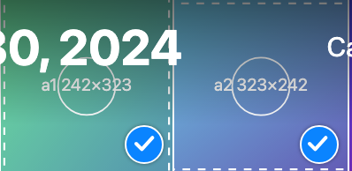
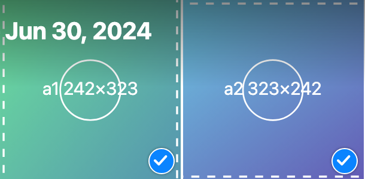

Refs #258. **Base: `feat/tile-overlays-208`** ([#249](https://github.com/pislagz/apple-photos-app/pull/249)). **#249 already fixes this**, so this PR only adds a regression test.

### Why you saw a blue dot
`feat/filmstrip-221` doesn't include #249. On that build, and on `main`, the iPhone selection badge is the old `.mobile-library__select-badge`: an empty 20 px circle whose fill **and** border both switch to the accent colour when selected, with no checkmark. That's exactly "a blue dot".

### What #249 already does (checked in Chromium, phone and desktop)
`CheckBadge` draws a 22 px accent circle with a 1.5 px white ring, a soft shadow and a white checkmark (an SVG stroke in `currentColor` = white), at the bottom-right. In iPhone select mode an unselected tile shows the outlined empty circle. Computed values on desktop: background `rgb(10, 132, 255)`, ring white, check stroke white.

| iPhone (select mode, two selected) | Desktop |
|---|---|
|  |  |

### This PR
- One test in `TileOverlays.test.tsx` pins the look: a white `currentColor` stroke check, a white 1.5 px ring, the accent fill, and the old `select-badge` gone from the CSS. #249's tests only checked `data-selected`.

⚠️ If you'd rather not have a PR that's only a test, close this one and close #258 when #249 merges.
