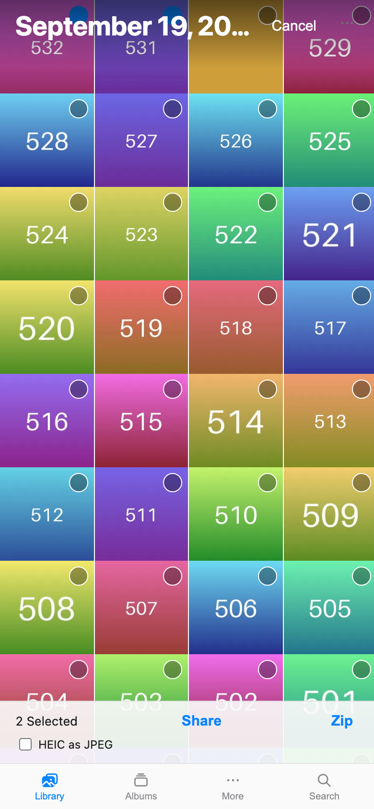
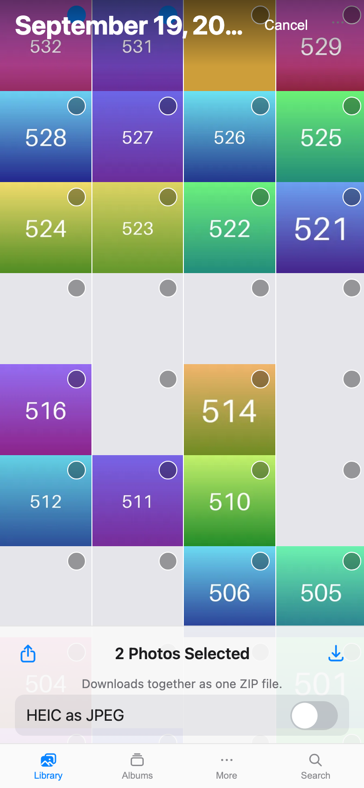
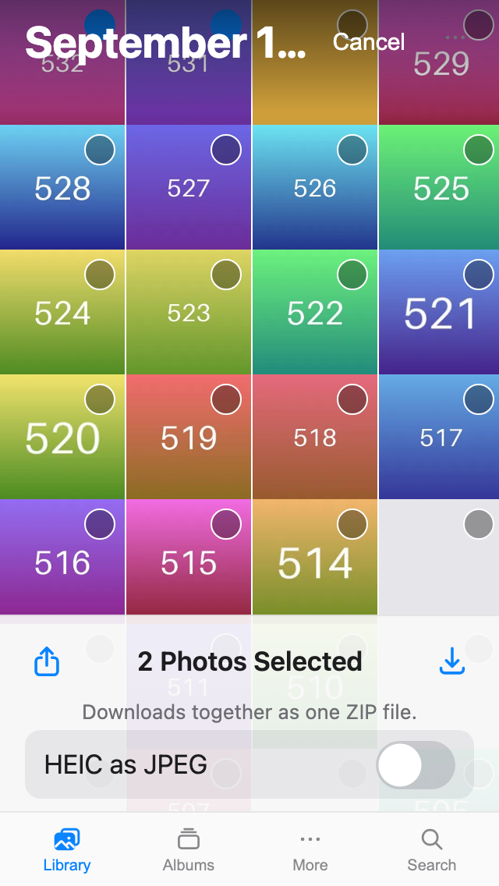

Fixes #259. **Base: `feat/254-heic-option-only-for-heic`** (the #254 PR). It's stacked because the issue says the HEIC option should only appear for a HEIC selection, and that's #254. Retarget it to `main` once #254 merges.

### What changed (iPhone select bar)
| | Before | After |
|---|---|---|
| Height | about 40 px, text buttons | a 49 pt toolbar row like Photos, plus the caption and option rows |
| Layout | count on the left, then Share and Zip | **Share** icon on the left, **count centred**, **Download** icon on the right |
| Count | "2 Selected" | "2 Photos Selected", "1 Video Selected", "3 Items Selected" for a mix |
| Targets | text only | 44 × 44 pt minimum for every button |
| Zip | "Zip" | **Download** (download icon), with a caption: "Downloads together as one ZIP file." (one photo: "Downloads as a ZIP file.") |
| HEIC option | small checkbox | full-width 44 pt row with an iOS-style switch, shown only when the selection has a HEIC photo (#254) |

The count sits in the middle column of a three-column grid whose two outer columns are equal, so it stays centred whatever the buttons' widths. Zip progress and errors appear as their own centred line under the row.

⚠️⚠️⚠️ **Wording is for you to decide** (the issue says "final wording with pp"):
- The caption: "Downloads together as one ZIP file." / "Downloads as a ZIP file."
- The option label: I kept "HEIC as JPEG", the same as desktop. "Convert iPhone photos to JPEG" may read better for non-technical users.

⚠️ **Download is an icon-only button** (accessible name "Download"), like the icons in Photos' own select toolbar. I first tried an icon plus a "Download" label, but at 320 px wide it ran into the centred count ("2 Photos Selected"). So the caption under the row carries the words. If you want the visible word, the count has to get smaller or move off-centre.

⚠️ With one photo selected, Download still makes a ZIP, the same behaviour as Zip before. A single file could download directly instead. Say if you want that, and I'll wire it to the viewer's single download (it would then need its own HEIC → JPEG handling).

### Tests
- `selectionText.test.ts`: the count wording for photos, videos, a mix, and ids that aren't loaded.
- `MobileLibrary.test.tsx` checks:
  - the row order is Share, count, Download;
  - there's no "Zip" button any more;
  - both buttons are disabled until something is selected;
  - the count text and caption are right;
  - the HEIC option is a `role="switch"` row;
  - a CSS check enforces the 49 pt row and the 44 pt minimums.
- **New `e2e/select-bar.e2e.ts`** (iphone and small projects). On the real demo it checks:
  - Share and Download are both at least 44 × 44;
  - Share ends before the count, and Download starts after it;
  - the count is centred within 2 px;
  - the bar is at least 49 px tall;
  - if a HEIC is selected, the option row is at least 44 px tall and spans the bar.
- vitest 500/500, `tsc`, and `check-colours` pass. The e2e passes on the `scripts/dev_demo.py` demo built from this branch.

### Screenshots (390×844, demo library)
| Before | After |
|---|---|
|  |  |

Small phone (320 px): 
