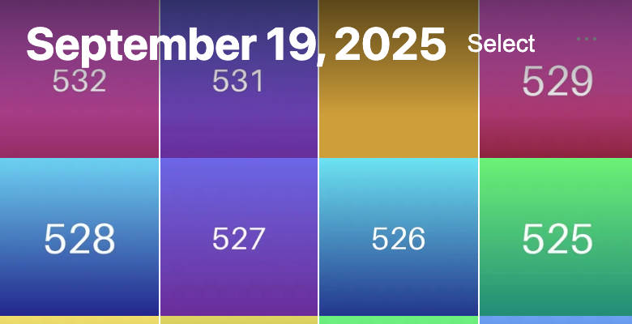
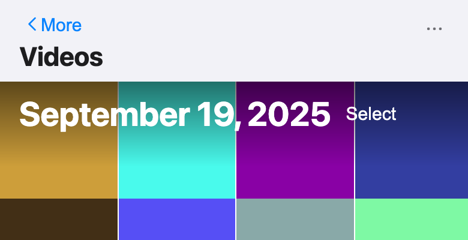
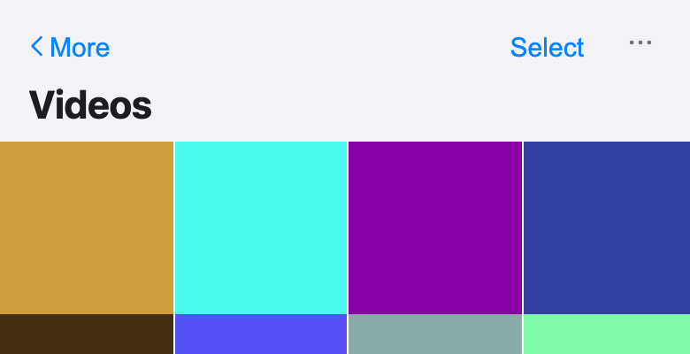

Fixes #260. **Base: `main`.** It also merges cleanly into `feat/filmstrip-221`; I checked with `git merge-tree`.

### Cause
Every pushed phone grid was built from two headers stacked on top of each other: a `.mobile-screen__header` (back button and title), then the grid's own overlaid date bar holding Select. That covers More → Videos, Screenshots and the other media types, an album, a person, and the photos at a place. So in these grids Select sat 78 px from the top, compared with 10 px in the Library, and it sat on a date scrim under the title.

### Fix
There's now one shared header component, `library/MobileGridHeader.tsx`, and `MobileLibrary` always renders it.
- **Library:** unchanged. The large date title sits over the photos on the scrim, with Select on the right.
- **Pushed grids** (`MobileLibrary nav={{ title, backLabel, onBack }}`): the first row has the back button on the left and Select on the right, and the large title wraps onto its own line below. The bar uses the grouped background, the way iOS Photos shows an album. Select uses the accent colour here, because there's no photo behind it.
- The first row has the same padding in both, and Select is aligned to the top of that row instead of centred, so it sits at exactly the same spot. The shell's floating account button sits next to it in every grid.
- `AlbumPhotos`, `PeopleScreen` (one person) and `PlacesScreen` (photos at a place) drop their own header and pass `nav` instead.

Measured on the demo at 390×844:

| Grid | Select before | Select after |
|---|---|---|
| Library | y 10.5 | y 10 |
| More → Videos | y 78.5 | y 10 |
| More → Screenshots | y 78 | y 10 |

The x position is the same everywhere.

⚠️ In pushed grids, the overlaid date label ("September 19, 2025") is gone. iOS Photos doesn't show it in an album either; the title is the header. Tell me if you want it back under the title.

⚠️ I left the Search tab alone. It's a root tab with the search field in its header, so there's nothing to push back from.

### Tests
- `MobileLibrary.test.tsx`: a pushed grid has exactly one top bar containing the back button, Select and the title in that order, with no scrim, no date label and no zoom switch. The back button calls `onBack`.
- **New `e2e/grid-header.e2e.ts`** (iphone and small projects): it measures Select in Library → All Photos and in More → Videos and More → Screenshots. Each must be within 1 px on both y and the right edge, and there must be one top bar only.
- vitest 491/491, `tsc`, and `check-colours` pass.
- On the real `scripts/dev_demo.py` demo, `grid-header`, `search`, `map`, `polish` and `shots` all pass.

⚠️⚠️⚠️ **This PR also fixes two e2e specs that were already broken on `main`:**
- `search.e2e.ts` and `map.e2e.ts` clicked `getByRole("button", { name: "Sign in" })`. That locator now also matches "Sign in with a passkey", so Playwright's strict mode failed at login. It's now `exact: true`.
- `search.e2e.ts` waited for `img[alt^="IMG_"]`. Since #200, alt text is "Photo from …", never the filename. It now looks for the grid cells instead.

### Screenshots (390×844)
| Library (unchanged) | Videos before | Videos after |
|---|---|---|
|  |  |  |
