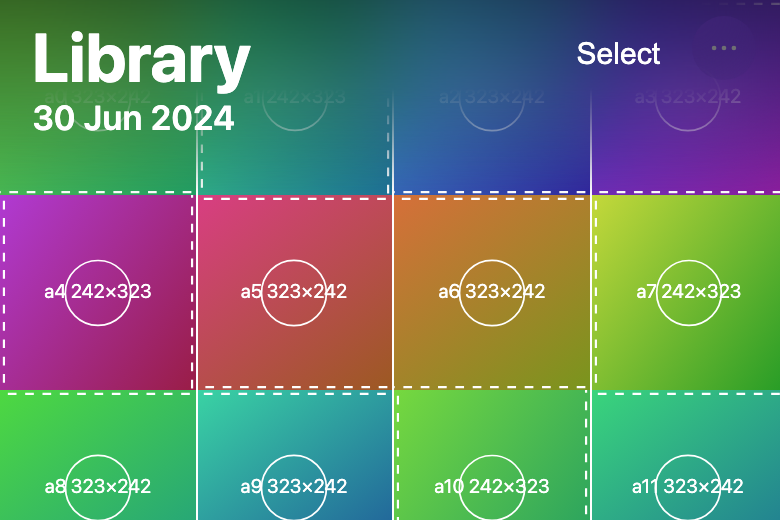
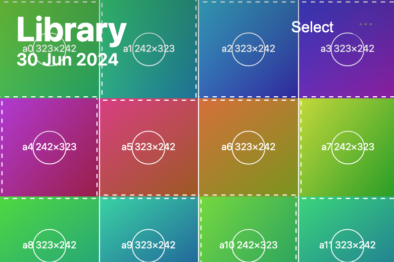
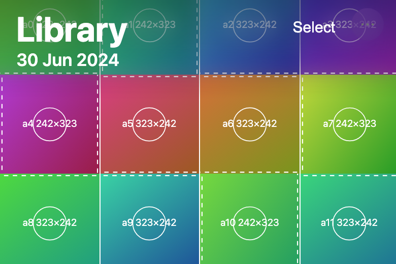
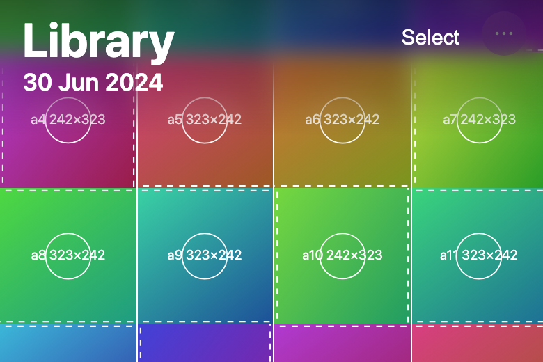
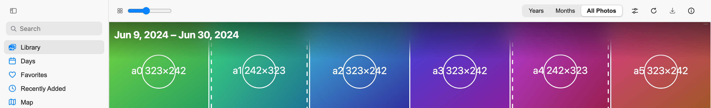
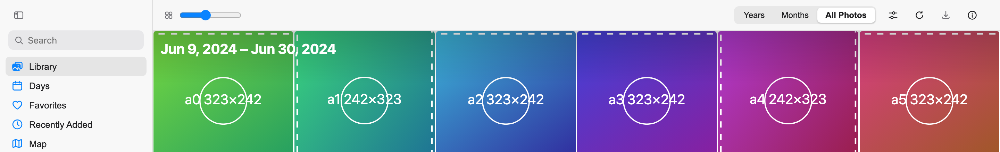
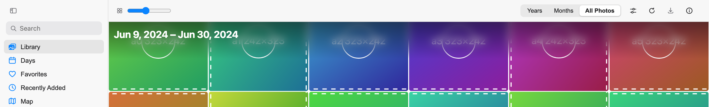

Fixes #261. **Base: `feat/title-209`** ([#243](https://github.com/pislagz/apple-photos-app/pull/243)).

### What changed
- **Lighter blur:** `backdrop-filter: blur(20px)` became `blur(8px)`, on both the desktop title scrim and the iPhone top bar.
- **Fades in with scroll instead of being on from the start:**
  - A new `--title-scrim` variable goes from 0 to 1 over the first **48 px** of scroll, via `titleScrimProgress()` in `libraryTitle.ts`.
  - It's set inline from the virtualizer's scroll offset: on `.desktop-library__date-range` on desktop, and on the top bar in iPhone All Photos.
  - The blur's opacity follows it directly. Negative (rubber-band) offsets count as 0.
- **Tint fades with it:** the dark gradient goes from 40 % to 100 % over the same 48 px.
- **Reduce Transparency:** under `@media (prefers-reduced-transparency: reduce)` there's no blur, only the full-strength tint.
- **Reduce Motion:** the fade is tied to the scroll position, not run on a timer, so nothing animates on its own and nothing needs disabling. The existing 150 ms title cross-fade is still turned off by the global reduced-motion rule.

### ⚠️⚠️⚠️ Two judgement calls, please check
1. **The tint doesn't start at 0.** The issue says to fade "it (and its tint)" in. At scroll 0, photos sit under the white title and Select on both layouts. With no tint at all, the white text disappears on bright photos, which is the legibility problem #176 fixed. So the tint starts at 40 % of its strength (about 0.2 black at the very top) and reaches full strength with the blur. To make it fade from nothing, change `calc(0.4 + 0.6 * …)` to `var(--title-scrim, 1)` in `shell.css`.
2. **iPhone Days keeps the full scrim** (`--title-scrim: 1`). Days has no date title, only Select over the hero photo (#176), so it isn't part of this issue.

### Tests
- `libraryTitle.test.ts`:
  - `titleScrimProgress` returns 0 for 0, negative and NaN offsets, 0.25 at 12 px, 0.5 at 24 px, and 1 from 48 px.
  - The CSS has `blur(8px)`, the variable-driven opacities, and no blur under Reduce Transparency.
- `MobileLibrary.test.tsx`: All Photos goes from `--title-scrim` 0 to 0.5 to 1 while scrolling; Days stays at 1.
- vitest 503/503, `tsc`, and `check-colours` pass.
- Checked in Chromium (Vite dev with a mocked `/api`) at 0, 24, 60 and 300 px. On iPhone the blur's opacity measured 0, 0.5, 1, 1, and the variable did the same on desktop.

### Screenshots (top of the iPhone 390 px layout, test images)
| Before, at rest (20 px blur already smearing the top row) | After, at rest | After, 24 px | After, 60 px |
|---|---|---|---|
|  |  |  |  |

Desktop (1440 px), before and after at rest, and after at 60 px:

