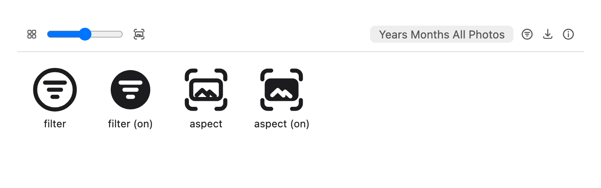

Fixes #264.

### What changes
- **Filter By icon:** redrawn as Photos' filter symbol, a circle with three lines of decreasing length. It's drawn on our own 20×20 grid in the #235 style (1.5 stroke, round caps), not taken from SF Symbols. The "on" state (a filter is active) is the solid circle with the lines knocked out.
- **Aspect toggle icon:** the old `rotate` arrow (which meant nothing here) is replaced by a new `aspect` icon: a whole landscape photo inside the corner marks of a square tile, meaning "show the whole photo instead of cropping to the square". It's solid when on.
- **Placement:** the toggle now sits **right after the grid-size slider**, in the same group, instead of between the Filter and Download buttons.
- **Labels:** the toggle is a constant toggle button, `aria-label="Show Whole Photos"` plus `aria-pressed`, with a tooltip that names what a click does ("Show Whole Photos" / "Show Square Tiles"). Filter By has an `aria-label` as well as its tooltip, instead of only an `sr-only` span.
- `rotate` was used only by this button, so it's removed from the icon set. `icons.test.tsx` lists `aspect` instead.

### Tests
`DesktopLibrary.test.tsx` asserts that the toggle is the slider's next sibling, has its label and tooltip, and flips `aria-pressed` and the tooltip on click, and that Filter By has an `aria-label` and title. The full web suite and `tsc` pass.

The screenshot above is the real `Icon` component rendered at toolbar size (16 px) and at 64 px, not the running app. The toolbar row only mocks the layout.

[#244](https://github.com/pislagz/apple-photos-app/pull/244) also edits `DesktopLibrary.tsx`, but not the toolbar JSX. A small, mechanical rebase conflict is possible, depending on which lands first.
