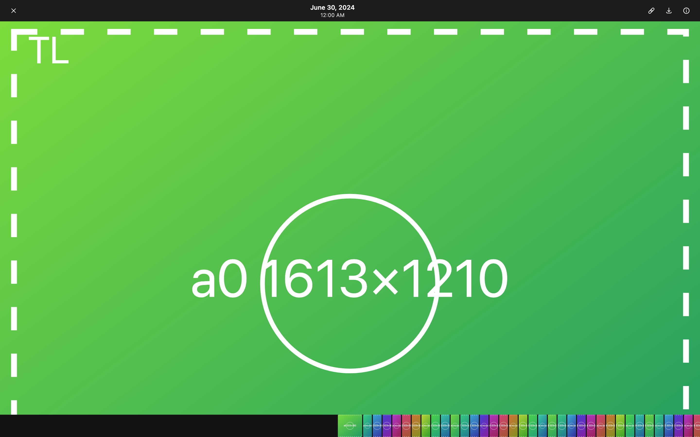
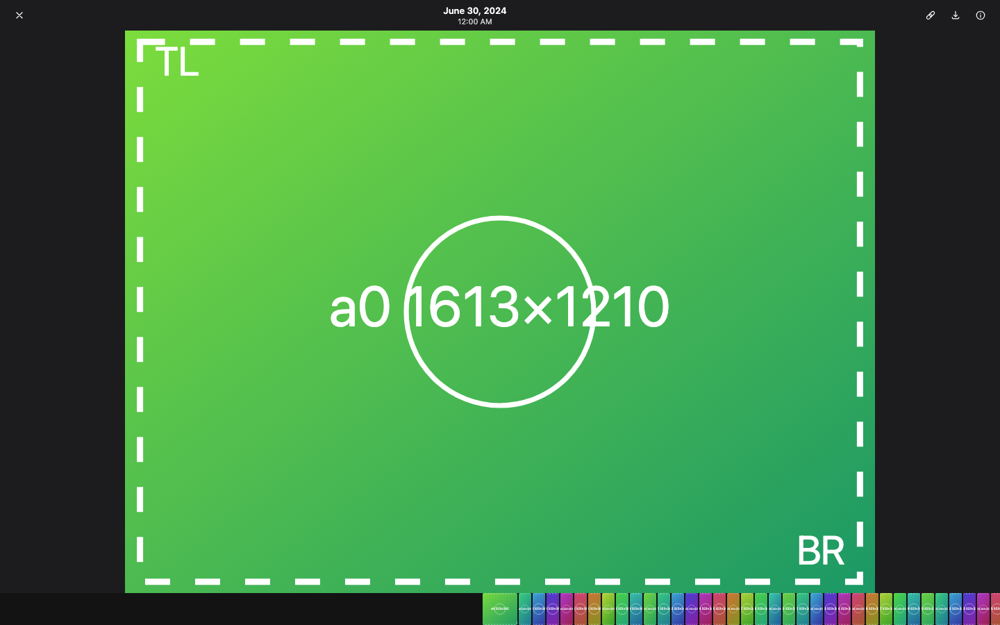
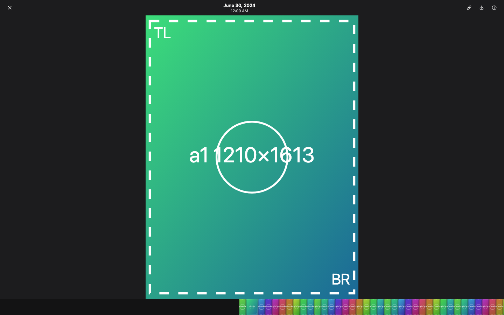
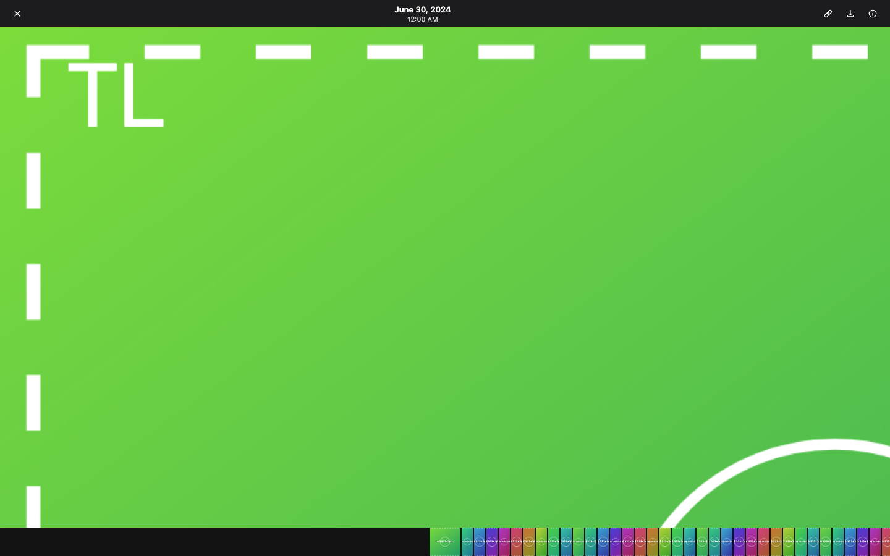
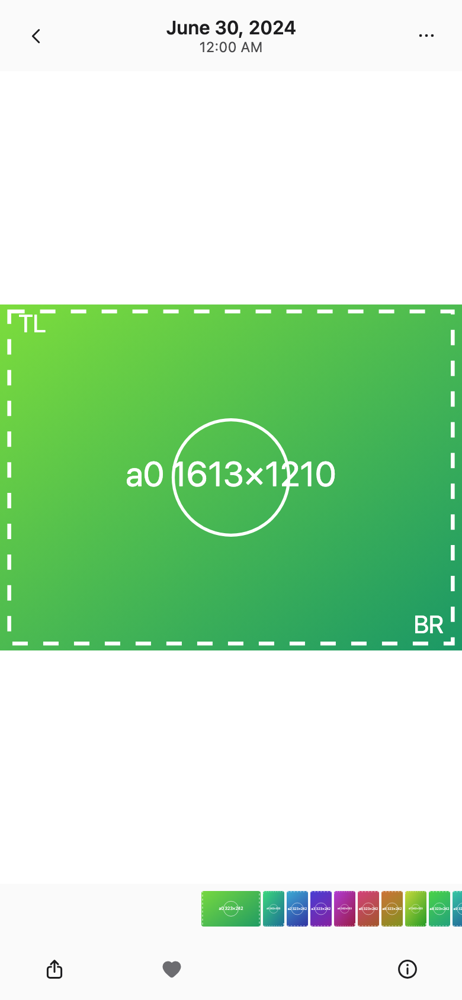
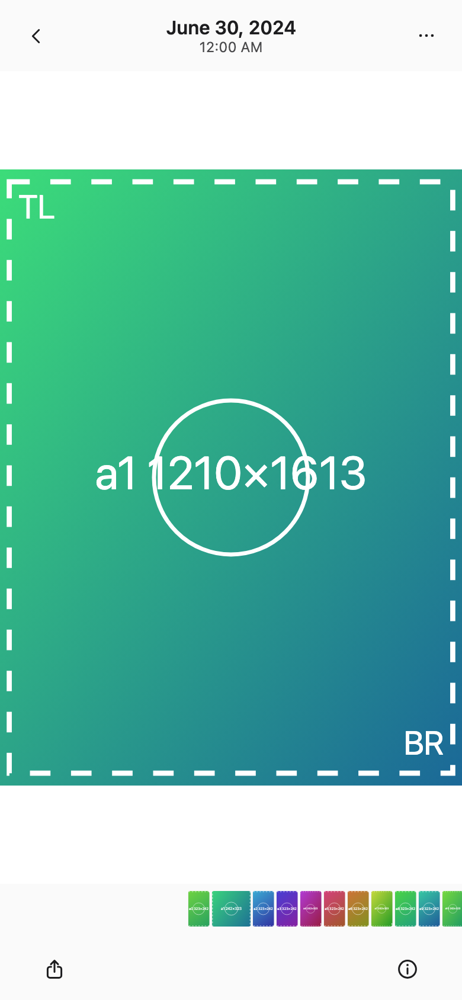
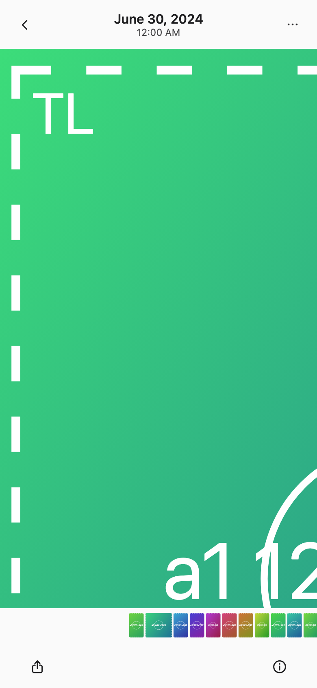

Fixes #267. **Base: `feat/filmstrip-221`** ([#248](https://github.com/pislagz/apple-photos-app/pull/248)), so it lands with the stack it unblocks.

### Cause
`.viewer-still` is a one-cell CSS grid holding the still (and the preview beneath it while the original loads). Its row was `auto`. An auto row grows to fit its content, so the `` (width 100%) got the photo's **natural aspect at full stage width**. On a 1440×900 window a 4:3 photo became 1440×1080, which overflowed the 810 px stage and was clipped by `overflow: hidden`. That looked like "cover". The zoom and pan maths compute the fitted size from the photo's dimensions, so it no longer matched what was on screen. As a result zoom-out ended at that clipped size and panning only half worked.

On the phone, the page wrapper already gave the grid a definite height, so iPhone was fitting correctly. The CSS fix applies to both anyway.

### Fix
1. **Fitted on open.** `.viewer-still` gets `grid-template: minmax(0, 1fr) / minmax(0, 1fr)` and `min-width/min-height: 0`, so the image box is the stage and `object-fit: contain` actually fits. The minimum zoom is the fit (scale 1), as before.
2. **Zoomed pan in both axes, clamped.** The desktop drag now listens on the **window** while the button is held. Before, it listened on the stage and ended on `mouseleave`, so a quick drag that left the stage froze the photo short of its edge. The pan is still clamped to the photo's edge.
3. **At fit on desktop**, a mouse drag now behaves like Photos. The photo follows the drag along the locked axis (a downward drag also shrinks it). On release, a drag of more than 80 px sideways pages to the previous or next photo (or a quarter of the width on narrow windows), more than 100 px down closes, and anything else snaps back. The helpers are `fitDragView` and `fitDragOutcome` in `gestures.ts`. iPhone already had swipe-to-page and swipe-down at fit.

### ⚠️⚠️⚠️ Extra fix in the same PR: the Viewer never closed in dev (StrictMode)
While testing I found that on this stack **Escape, the close button and swipe-down never close the viewer in `vite dev`**. `useDismiss` set `alive.current = false` in an effect cleanup and never set it back. StrictMode runs mount, cleanup, mount, so after the first mount every zoom-out close bailed in `finish()`. Production builds aren't affected, because StrictMode double-mounting only happens in dev. The fix is one line (`alive.current = true` on mount) plus a StrictMode test. If the demo server serves the dev build, this is probably part of what you saw.

### ⚠️ Flaky test made deterministic
`HiddenView.test.tsx` "paging … loads the next page (#174)" swiped 120 px on a 1024 px jsdom window. That's below the 25 % distance threshold, so it only paged by velocity, and velocity is 0 when `touchstart` and `touchmove` land in the same millisecond. With this branch's module timing it failed about 3 runs in 4. The test now swipes 520 px. Viewer behaviour is unchanged.

### Tests
- `gestures.test.ts`: `fitDragView` / `fitDragOutcome` thresholds.
- `DesktopViewer.test.tsx` "fit, zoom and pan (#267)": the CSS track rule; at fit a sideways drag pages and a downward drag closes; short drags and drags up snap back; a drag that leaves the stage still pans to the edge on both axes.
- `useDismiss.test.tsx`: a zoom-out close finishes under `<StrictMode>`.
- **`e2e/viewer-fit.e2e.ts`** (new, runs in the desktop, iphone and small projects). It opens a landscape and a portrait photo and checks:
  - the painted rect is inside the viewport;
  - ctrl+wheel or pinch zoom-out stays at scale 1;
  - a diagonal drag when zoomed moves both x and y;
  - dragging far past the edge stops the photo edge exactly at the stage edge;
  - at fit, a drag or swipe down closes.
  
  A desktop-only test checks that a drag at fit pages forward and back.

Results:
- vitest 588/588, `tsc`, and `check-colours` pass.
- The new e2e spec passes in all three projects (4 passed, 2 skipped by design).
- Against this branch's base source, the same spec fails all three runs: desktop opens at 1124 px tall in a 900 px window, a drag at fit doesn't page, and iPhone swipe-down doesn't close.

The spec ran in two places:
- **Against the Vite dev server with a mocked `/api`.** The mock serves SVG test photos at 4032×3024 and 3024×4032 with corner markers. This is the run that reproduces the bug: it fails on the base and passes here.
- **Against the real `scripts/dev_demo.py` demo**, built from this stack. All viewer-fit tests pass, including a new check that the fitted photo touches the stage on one axis. Making it pass on the real server needed some fixes to the spec:
  - it skips videos and Live Photos;
  - it waits until the converted original has decoded (`naturalWidth > 0`);
  - it waits for the open zoom to finish;
  - it parses transforms with `DOMMatrix`, because the browser can report values like `1.4e-14px`;
  - the paging test now opens a still photo.

⚠️⚠️⚠️ **The demo library can't reproduce the bug itself.** Its synthetic images are 480×640 and 640×480. They're never taller than the stage, so the auto grid row never overflows, and the same spec also passes on the base build. On the demo, the CSS unit test and the mocked run are what guard against this regression. Your real libraries (full-size previews) are where you'd have seen it.

⚠️⚠️⚠️ **This failure was already there before this PR:** `e2e/polish.e2e.ts` "reduced motion › motion on: viewer dismiss animates" fails in all three projects because `.is-closing` never appears. It fails the same way on a demo built from the base `feat/filmstrip-221`. The zoom-to-tile close from #220 replaced the fade that the test waits for. I left it alone, because the fix is either to update the test for #220 or to change #220.

### Screenshots (desktop 1440×900, iPhone 390×844)
| Before (desktop, landscape): clipped, bottom-right marker missing | After (desktop, landscape) |
|---|---|
|  |  |

| After (desktop, portrait) | After (desktop, zoomed, panned to the top-left edge) |
|---|---|
|  |  |

| iPhone, landscape | iPhone, portrait | iPhone, zoomed portrait at the edge |
|---|---|---|
|  |  |  |

Cursor feedback while dragging (#257) is in its own PR, stacked on this one.
