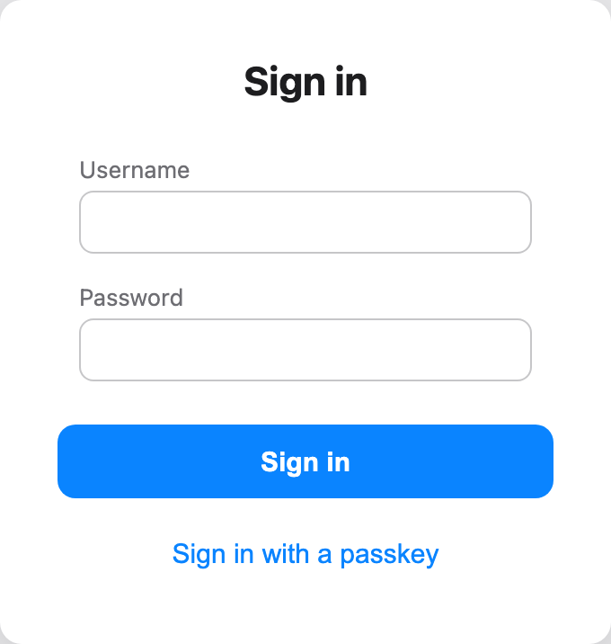
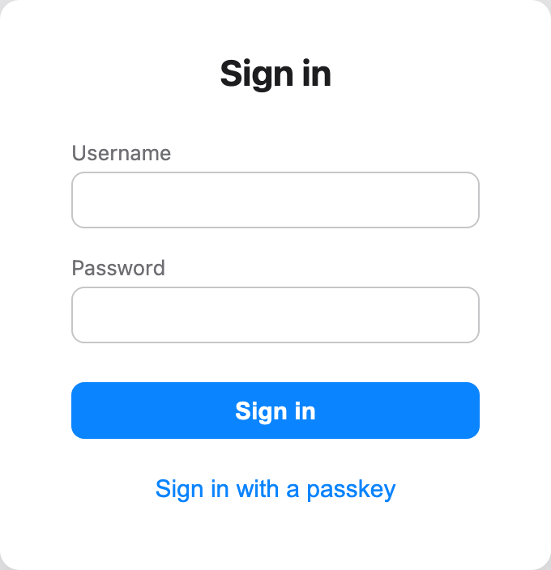
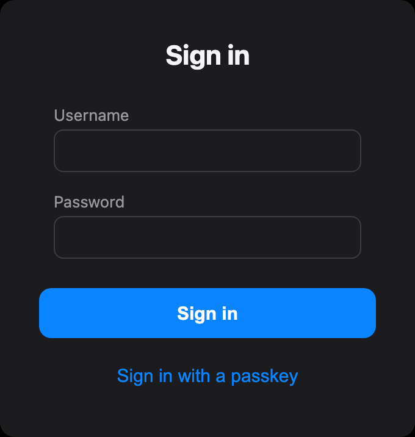
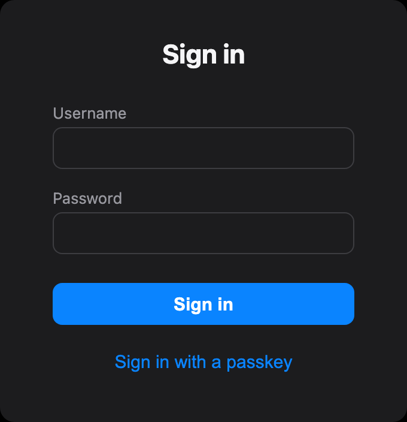
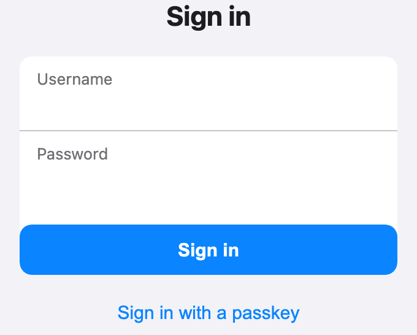
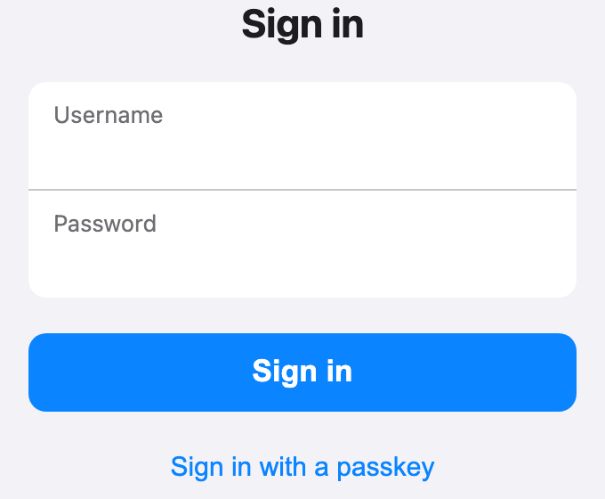
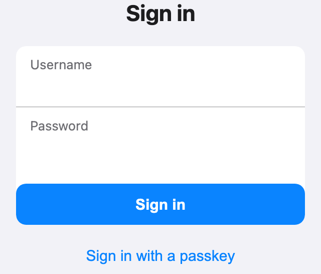
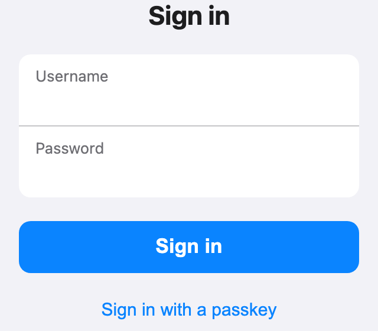

Login: the Sign in button no longer overhangs the fields, on every breakpoint. **Base: `main`.** No issue number; pp reported it in chat.

### Cause
The inputs sit inside labels that have 12 px side padding, but the button spanned the form's full width. On desktop that made it 24 px wider than the fields (276 px against 252 px) and taller (41 px against 35 px). On phones the fields' white card was the form itself, so the button sat fused onto the card's bottom edge.

### Fix (`shell.css` only)
- **Desktop:** the button gets the labels' side margin, padding that matches the inputs, and a transparent 1 px border. It's now exactly as wide and tall as the inputs (252 × 35), with the same 8 px corner radius.
- **Phone (390 and 320 px):** the two field rows are now the rounded inset group themselves. The button sits 20 px below the group, the same width, 44 pt tall, at iOS's 17 px font size.
- The new rules only target the form's direct child labels, so the first-run Setup screen's checkbox rows are unaffected.

### Tests
- **New `e2e/login-layout.e2e.ts`**, run against the demo. Desktop: the button lines up with the inputs within 1 px on x, width and height. Phone: it matches the group's x and width, is 44–50 px tall, and sits at least 8 px below the group. It passes in all three projects.
- vitest 490/490 and `check-colours` pass.

| | Before | After |
|---|---|---|
| Desktop |  |  |
| Desktop, dark |  |  |
| iPhone |  |  |
| 320 px |  |  |
